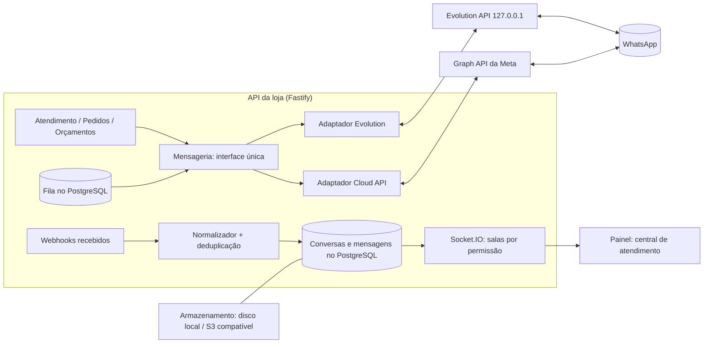

# Integrações, WhatsApp e automações — proposta para aprovação

Primeira entrega pedida no adendo de integrações (item 16) e na diretriz de instalar só o que é gratuito. **Nada foi
instalado nem alterado.** Licenças e preços conferidos nas fontes oficiais em 14/11/2026 (lista no fim).

## 1. Diagnóstico

### 1.1 O que a loja já tem e serve de base

| Peça | Situação hoje | Aproveitamento |
|---|---|---|
| WhatsApp | Interface de provedor (`apps/api/src/lib/whatsapp.ts`) com a **Cloud API oficial**: envio de modelo e texto, assinatura e verificação do webhook, simulador para desenvolvimento. Nada testado contra a Meta ainda. | Vira um dos dois provedores da nova camada de mensageria. |
| Fila de envio | Tabela `whatsapp_messages` (uma mensagem por pedido e evento, sem duplicar), envio na rotina de 60 s com novas tentativas. | Base da fila genérica no PostgreSQL (seção 3.4). |
| Caixa de entrada | `whatsapp_inbound` deduplicada pelo id da mensagem, resposta só dentro da janela de 24 h, lista de bloqueio "SAIR" (`whatsapp_optouts`). | Vira a central de atendimento. |
| Orçamentos | Busca de produto, orçamento com vários itens, link público com aceite, compartilhamento, conversão em pedido. | Já cobre boa parte do item 10 do adendo. |
| Preço | Preço por embalagem com faixas progressivas por quantidade (`price_tiers`). | Simulação de 50, 100, 500 unidades usa isso. |
| Permissões e auditoria | Papéis com permissões, auditoria permanente com IP, MFA. | Novas permissões: `atendimento.*`, `integracoes.manage`. |
| Credenciais | Criptografia AES com `ENC_KEY` (`lib/crypto.ts`). | Credenciais das integrações guardadas cifradas. |
| Arquivos | Disco local `storage/` (fotos WebP, XML e DANFE), protegido (750), no backup. | Fica atrás de uma interface de armazenamento. |

**O que não existe e o adendo pede:** preço "profissional" separado do varejo (hoje só há faixas por quantidade;
**a regra comercial é sua**, não vou inventar), descontos com regra e alçada, tempo real (o painel só atualiza ao
recarregar), mídia no WhatsApp (só texto), atendente responsável por conversa, tela de Integrações.

### 1.2 Servidor (auditoria de 14/11/2026)

- 2 vCPU, 7,9 GB de RAM (~5,5 GB livres com tudo rodando), 2 GB de swap, 83 GB livres em disco.
- Já rodam: loja (API ~50–80 MB, site ~150–170 MB, PostgreSQL próprio), barbearia, vitrine, central de backup,
  CloudPanel, MySQL, PostgreSQL do sistema, Redis, Varnish, e-mail (Postfix/Dovecot), PM2 e outros Node.
- **Não há Docker instalado.** Instalar Docker num servidor com CloudPanel tem um efeito colateral sério: o Docker
  escreve regras próprias de firewall e **portas publicadas por contêiner passam por cima do ufw**. Recomendo não
  instalar Docker neste VPS (seção 3.6).
- O Redis existente (127.0.0.1:6379) é de outro sistema: não compartilhar.
- O nginx da loja não repassa WebSocket hoje (faltam os cabeçalhos `Upgrade`/`Connection`); o tempo real precisa de
  um bloco próprio no `loja.conf`.

## 2. Licença, custo e decisão (diretriz de gratuidade)

A = gratuita, pode instalar · B = gratuita com limite ou custo opcional · C = paga ou depende de contratação.

| Integração | Licença / modelo | Instalação própria | Custo externo | Classe | Decisão |
|---|---|---|---|---|---|
| **Evolution API** | Apache 2.0 **com condições extras**: avisar os administradores, de forma visível, que o sistema usa a Evolution API; manter logo e copyright se usar o painel dela; descumprir pode exigir licença comercial | Sim (Node 20+, PostgreSQL ou MySQL, Redis opcional) | R$ 0 de licença; RAM do VPS | A, **com ressalva de risco** (3.1) | **Instalar** na etapa 1, se você aceitar o risco do modo WhatsApp Web |
| WhatsApp Cloud API (Meta) | Serviço da Meta, cobrança por mensagem desde 01/07/2025 | Não (nuvem da Meta) | Desde **01/10/2026**: 1.000 mensagens de atendimento grátis por mês por número; acima disso e todos os modelos (utilidade, marketing, autenticação) são cobrados por mensagem, pela tabela da Meta | B/C | **Preparado** (o adaptador já existe). Não ativar sem sua autorização |
| Chatwoot | MIT (fora da pasta `enterprise/`, que tem licença própria) | Sim (Rails, Sidekiq, PostgreSQL, Redis) | R$ 0 de licença; **mínimo de 4 núcleos e 4 GB de RAM** pela documentação | A na licença, **não cabe no VPS** | **Preparar** a integração; instalar só em servidor separado, com sua autorização de custo |
| Typebot | Functional Source License (vira Apache 2.0 após 2 anos). Pode criar bots para a própria empresa; não pode revender acesso nem hospedar para terceiros | Sim (dois apps Next.js + PostgreSQL) | R$ 0 de licença; RAM | A para o nosso uso | **Etapa 2**, depois de medir o VPS com a Evolution rodando |
| OpenAI | API paga por uso | Não | Ex. (tabela oficial em 14/11): gpt-5-nano US$ 0,05 / 0,40 por milhão de tokens (entrada/saída); transcrição gpt-4o-mini-transcribe ~US$ 0,003 por minuto | C | **Só adaptador**, desligado. Nenhuma chamada paga |
| Dify | Apache 2.0 modificada: proíbe uso multiempresa (SaaS) sem autorização escrita; manter logo/copyright no painel | Sim (~10 serviços: API, workers, web, PostgreSQL, Redis, Weaviate, sandbox, plugins, nginx) | R$ 0 de licença; **mínimo de 2 núcleos e 4 GB**; sem um modelo de IA (pago) faz pouco | A na licença, **não cabe**, e depende de C | **Não instalar agora.** Só se a etapa 3 for aprovada, e em outro servidor |
| RabbitMQ | MPL 2.0 | Sim | R$ 0; a documentação pede **4 GB de RAM por nó** em produção, sem dividir a máquina com outros serviços de dados | A na licença, **não justificado** | **Não instalar.** Adaptador preparado; a fila no PostgreSQL atende o volume atual |
| Apache Kafka | Apache 2.0 | Sim | R$ 0; pesado (JVM) | A na licença, **não justificado** | **Não instalar.** Só a interface de fila deixa a porta aberta |
| Amazon SQS | Serviço AWS | Não | Conta AWS: créditos iniciais por até 6 meses, depois plano pago | C | **Só adaptador**, desligado |
| Socket.IO | MIT | Sim (biblioteca dentro da API) | R$ 0; poucos MB | A | **Instalar** na etapa 1 (dentro da API, sem serviço novo) |
| MinIO | AGPL 3.0; **repositório arquivado em 25/04/2026 e sem manutenção** ("no longer maintained"); imagens prontas deixaram de ser distribuídas em out/2025 | Só compilando do código, sem correções de segurança | R$ 0, mas sem manutenção | **Não recomendado** | **Não instalar.** Disco local + adaptador compatível com S3 |
| Amazon S3 | Serviço AWS | Não | Pago por GB e por requisição após os créditos | C | **Só adaptador** (o mesmo serve a qualquer serviço compatível com S3) |

Custo de licença zero não é custo zero: cada serviço instalado gasta memória do VPS, precisa de atualização,
backup e monitoramento.

## 3. Arquitetura proposta

### 3.1 WhatsApp: a decisão que depende de você

A Evolution API tem dois modos:

- **WhatsApp Web (Baileys)**: conecta por QR Code como se fosse um celular com WhatsApp Web. É gratuito, mas **não
  é oficial**: o próprio projeto avisa que depende da versão do WhatsApp Web e tem limitações. O número pode ser
  **desconectado ou banido** pelo WhatsApp, e há relatos de mensagens recebidas que deixam de gerar aviso depois de
  um tempo. O adendo diz "não utilizar mecanismos que simulem indevidamente a interface do WhatsApp" e, ao mesmo
  tempo, pede a Evolution como primeira opção: **é exatamente esse modo**. Só sigo com ele com o seu aceite
  explícito do risco.
- **Cloud API**: a Evolution também fala com a API oficial da Meta, mas aí os custos são os da Meta e ela não
  acrescenta nada ao adaptador oficial que a loja já tem.

**Recomendação:** Evolution no modo WhatsApp Web **num número secundário**, nunca no número principal da empresa,
com envio só em resposta ao cliente ou aviso de pedido que ele pediu (nada de disparo em massa), e a Cloud API
oficial pronta para assumir quando o volume ou o risco justificarem. A troca é uma opção no painel.

### 3.2 Camada de mensageria (provedor trocável)

- A interface tem: `sendText`, `sendMedia` (imagem, documento, áudio), `sendTemplate` (só Cloud API),
  `connectionState`, `connect` (QR Code, só Evolution), `verifyWebhook`, `parseWebhook`.
- O webhook de cada provedor é normalizado num formato único (`mensagem recebida`, `situação de entrega`,
  `conexão mudou`) com chave de deduplicação pelo id da mensagem do provedor.
- Pedidos, orçamentos e avisos chamam só a interface. Trocar de provedor não mexe neles.
- Envio sempre pela fila (nunca direto da tela): limite por número e por minuto, nova tentativa espaçada, desistência
  registrada, nada de reenvio duplicado.
- Desconexão (Evolution): o estado vem pelo aviso de conexão e por uma checagem periódica; reconexão automática
  limitada (ex.: 3 tentativas espaçadas) e depois aviso no painel pedindo novo QR Code. Sem loop de reconexão.

### 3.3 Central de atendimento (no próprio painel)

O que o adendo pede no item 10 está, quase todo, nos dados da loja: catálogo, estoque, faixas de preço, orçamento,
pedido, cliente. Proposta: **evoluir a caixa de entrada atual** para uma central no painel, em vez de depender do
Chatwoot já na etapa 1:

- Lista de conversas em tempo real, atendente responsável, situação (aberta, aguardando cliente, encerrada),
  etiquetas, transferência entre atendentes.
- Ao lado da conversa: cliente identificado pelo telefone, pedidos e orçamentos dele, situação de pagamento.
- Busca de produto (nome, SKU, departamento, marca), simulação de quantidade com as faixas, disponibilidade e
  "sob encomenda", criar orçamento, enviar link do produto ou do orçamento pela conversa.
- Mídia recebida (foto, áudio, documento) guardada no armazenamento, com tipo e tamanho conferidos.

O Chatwoot entra na etapa 2 **se** a central do painel não bastar (muitos atendentes, outros canais como Instagram
e e-mail). Nesse caso: servidor separado, a loja continua dona de preço, estoque e pedido, e o Chatwoot consulta a
loja por uma API autenticada.

### 3.4 Filas e eventos

- **Agora:** fila genérica no PostgreSQL da loja (tabela de tarefas com `FOR UPDATE SKIP LOCKED`, tentativas,
  próximo horário, erro), substituindo os laços soltos de 60 s aos poucos. Sem serviço novo.
- **Interface de fila** com o PostgreSQL como implementação; RabbitMQ, SQS e Kafka ficam como adaptadores **não
  instalados**, com o critério de quando valem a pena (ex.: mais de uma instância da API ou milhares de eventos por
  minuto).

### 3.5 Tempo real (Socket.IO)

- Dentro da API (mesmo processo), no caminho `/socket.io/`, com bloco próprio no nginx (WebSocket direto para a API).
- Autenticação pelo mesmo cookie de sessão do painel, conferência de origem, salas por permissão (`atendimento`,
  `pedidos`) e por conversa; o servidor só envia o que o usuário pode ver. Cliente da loja não conecta.
- Eventos: mensagem nova, conversa atualizada, estado do WhatsApp, pedido atualizado, tarefa da fila concluída.

### 3.6 Instalação da Evolution no VPS (sem Docker)

- Como serviço do systemd, igual à loja: usuário próprio, escutando só em `127.0.0.1`, sem porta aberta no firewall.
- Banco próprio (base e usuário separados) **no PostgreSQL da loja** (54330): não mistura dados com a loja e não
  sobe outro servidor de banco. Cache local da própria Evolution (`CACHE_LOCAL_ENABLED`), sem Redis.
- Os conectores internos dela (Chatwoot, Typebot, OpenAI, RabbitMQ, SQS, Kafka, S3, WebSocket) ficam **desligados**:
  a loja é quem integra.
- Versão fixa, atualizada à mão depois de ler as notas de versão.

### 3.7 Armazenamento

Interface `put/get/delete/urlTemporaria` com duas implementações: **disco local** (a de hoje, que continua) e
**compatível com S3** (preparada, desligada). Banco guarda só metadados. Limites por tipo (foto, áudio, documento),
conferência do conteúdo real do arquivo, retenção configurável, espaço usado visível no painel.

### 3.8 IA (preparada, desligada)

Interface de IA com adaptador OpenAI desligado. Regras fixas no código, não no prompt: a IA **só sugere**
(resposta, resumo, classificação, transcrição); toda ação (preço, desconto, pedido, pagamento, nota) passa pelas
rotas normais com permissão e confirmação humana. Limite de gasto mensal configurável, obrigatório antes de ligar.
Dados de outros clientes nunca entram no contexto.

### 3.9 Tela "Integrações"

Uma linha por serviço com: situação **verificada** (teste real de conexão, nunca "conectado" só por ter
credencial), data da última verificação, último erro, registro técnico, instruções, ligar/desligar. Os serviços não
instalados aparecem como "Preparado — não instalado", com o motivo. O aviso de uso da Evolution exigido pela licença
fica nessa tela.

## 4. Consumo estimado no VPS

Estimativas a confirmar medindo depois da instalação (o mesmo monitor da auditoria).

| Item | Memória | CPU | Observação |
|---|---:|---|---|
| Evolution API (1 número, cache local) | ~250–500 MB | baixa, picos ao sincronizar | medir; com muitos chats o histórico cresce |
| Base da Evolution no PostgreSQL da loja | +50–150 MB | baixa | cresce com o histórico de mensagens |
| Socket.IO na API | +20–50 MB | baixa | dentro do processo existente |
| Fila no PostgreSQL | desprezível | baixa | |
| **Total da etapa 1** | **~0,4–0,7 GB** | | cabe nos ~5,5 GB livres |
| Typebot (etapa 2) | ~0,4–0,8 GB | baixa | só depois de medir a etapa 1 |
| Chatwoot | ≥ 4 GB e 4 núcleos | | **não cabe**: servidor separado |
| Dify | ≥ 4 GB e 2 núcleos | | **não cabe**: servidor separado |
| RabbitMQ / Kafka | ≥ 4 GB (RabbitMQ) | | não justificado |

## 5. Contas e credenciais

| Item | Quem providencia | Custo |
|---|---|---|
| Número secundário de WhatsApp (chip) para a Evolution | Você | do chip/plano da operadora |
| Celular para ler o QR Code na conexão | Você | — |
| Conta Meta Business + número verificado (Cloud API) | Você, só se for ativar | cobrança por mensagem da Meta |
| Chave da OpenAI | Você, só na etapa 3 e com limite de gasto | por uso |
| Servidor separado (Chatwoot/Dify) | Você, só se aprovar | a orçar |

## 6. Segurança e LGPD

- Credenciais cifradas no banco (`ENC_KEY`), nunca no log nem devolvidas à tela (só "configurada").
- Webhook da Evolution protegido por segredo próprio e aceito só de `127.0.0.1`; Cloud API pela assinatura HMAC já
  existente. Deduplicação por id e janela de validade contra repetição.
- Permissões novas: ver conversas, responder, transferir, gerenciar integrações (com MFA, como as áreas sensíveis).
- Limite de envio por número e por minuto; nada de envio em massa pela central.
- Logs com telefone e conteúdo mascarados.
- **Retenção e LGPD (decisão sua):** proposta de 12 meses para conversas e mídias de atendimento sem pedido,
  exclusão a pedido do titular (com exceção do que a lei fiscal obriga guardar), exportação dos dados de um
  cliente, opt-out "SAIR" que já existe valendo para todos os provedores.

## 7. Cronograma (blocos de trabalho)

| Bloco | Conteúdo | Depende de |
|---|---|---|
| 1 | Interface de mensageria, Cloud API movida para ela, Evolution como adaptador, normalização de webhook, fila no PostgreSQL, testes com simulador | aprovação desta proposta |
| 2 | Socket.IO, central de atendimento no painel (conversas, atendente, cliente, pedidos, orçamento, produto, mídia), tela Integrações | bloco 1 |
| 3 | Instalação da Evolution no VPS (systemd, sem Docker), conexão do número secundário, testes reais | seu aceite do risco e o chip |
| 4 | Adaptadores preparados e desligados: S3, OpenAI, SQS/RabbitMQ; documentação de instalação e manutenção | — |
| Etapa 2+ | Typebot, Chatwoot, IA, Dify: cada um só com nova aprovação e medição | — |

## 8. Testes e critérios de aceite

Automatizados (sem serviço externo): normalização dos dois formatos de webhook; mensagem duplicada ignorada; fila
sem envio duplicado com dois trabalhadores; reconexão limitada; permissões do Socket.IO (usuário sem permissão não
recebe nada); upload com tipo falso recusado; credencial nunca devolvida.

No servidor, com o número secundário (marcados em TESTES-PENDENTES até serem feitos de verdade): conectar por QR
Code; enviar e receber texto, foto, áudio e documento; desligar o celular e ver a reconexão e o aviso; mesma
mensagem reenviada pelo webhook não duplica; atendimento ligado a cliente e pedido; produto e orçamento enviados
pela conversa; painel no celular; tentativa sem permissão recusada.

Nada é declarado "operacional" sem esse teste real.

## 9. Decisões que preciso de você

1. **Aceita o risco da Evolution no modo WhatsApp Web** (não oficial, pode desconectar ou banir) num número
   secundário? Sem esse aceite, fica só a Cloud API oficial, que tem custo por mensagem.
2. **Sem Docker no VPS** (Evolution como serviço do systemd)?
3. **Central de atendimento no próprio painel** na etapa 1, deixando o Chatwoot para quando houver necessidade e
   servidor separado?
4. **Preço profissional e descontos:** quais as regras (quem tem direito, como se calcula, até quanto o atendente
   pode dar)? Sem isso, a central usa só as faixas por quantidade que já existem.
5. **Retenção** de conversas e mídias (proposta: 12 meses).

## Fontes consultadas (14/11/2026)

- Evolution API: README e LICENSE em github.com/EvolutionAPI/evolution-api; `.env.example` do mesmo repositório.
- Chatwoot: LICENSE em github.com/chatwoot/chatwoot; developers.chatwoot.com/self-hosted/deployment/requirements.
- Typebot: docs.typebot.com/self-hosting/get-started.
- Dify: LICENSE em github.com/langgenius/dify; docs.dify.ai (instalação com docker compose).
- MinIO: github.com/minio/minio (arquivado em 25/04/2026, "no longer maintained").
- WhatsApp: developers.facebook.com/docs/whatsapp/pricing.
- AWS: aws.amazon.com/free.
- OpenAI: developers.openai.com/api/docs/pricing.
- RabbitMQ: rabbitmq.com/docs/production-checklist.
